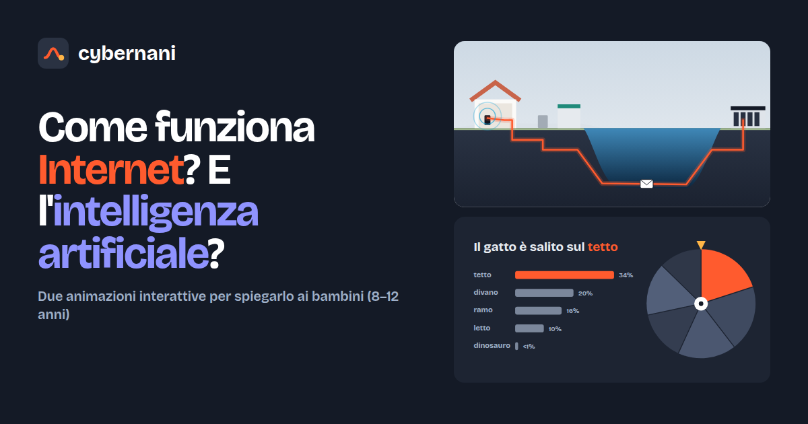

# cybernani

**Internet e intelligenza artificiale spiegati ai bambini (8–12 anni), con due animazioni interattive.**

👉 **[kindaichi-doyle.github.io/cybernani](https://kindaichi-doyle.github.io/cybernani/)**



Sono due pagine pensate per essere proiettate in classe e guidate da chi spiega, al posto delle slide. Ci si ferma quando arrivano le domande, si zooma, si torna indietro.

## Le animazioni

### [Il viaggio di un messaggio](https://kindaichi-doyle.github.io/cybernani/viaggio-messaggio/)
«Ciao dall'Italia!» parte dal telefono di Sofia e arriva a Sam, negli Stati Uniti. È una mappa continua e zoomabile, in 14 fermate: Wi-Fi, router, fibra sotto la strada, centrale del provider, la rete di reti a Milano, il cavo sottomarino, il data center, e poi la risposta che torna indietro. A ogni pezzo ci si chiede *cos'è, di chi è, chi può leggere il messaggio*. C'è un interruttore per il lucchetto (cifratura sì/no), che mostra la differenza tra una cartolina e una cassaforte, e ci sono link facoltativi a video reali.

### [La macchina che indovina parole](https://kindaichi-doyle.github.io/cybernani/intelligenza-artificiale/)
Si parte da un gioco con la classe: completare «Il gatto è salito sul…». Poi la stessa cosa la fa la macchina, tirando un dado truccato, e da qui si spiegano in 12 fermate:
- probabilità e stocasticità (stessa domanda, risposte diverse);
- la temperatura;
- le allucinazioni;
- i token;
- la compiacenza;
- l'AI che sembra una persona;
- come usarla bene.

Il modello linguistico è un modello **giocattolo**, con probabilità scritte a mano: nessuna AI vera, nessuna chiamata di rete, nessuna sorpresa in aula.

## Comandi

**Tasti in entrambe le pagine:**
- <kbd>←</kbd> <kbd>→</kbd>: fermata precedente / successiva
- <kbd>H</kbd>: nasconde il testo laterale
- <kbd>F</kbd>: schermo intero

**Il viaggio di un messaggio:**
- <kbd>Esc</kbd>: vista intera
- <kbd>L</kbd>: lucchetto
- <kbd>R</kbd>: rivede l'animazione della fermata
- <kbd>V</kbd>: apre il video della fermata
- clic su un elemento: zoom su quell'elemento
- rotellina e trascinamento: zoom e spostamento liberi

**La macchina che indovina parole:**
- <kbd>Spazio</kbd>: gira la ruota (una parola)
- <kbd>G</kbd>: frase intera
- <kbd>R</kbd>: rigioca
- <kbd>↑</kbd> <kbd>↓</kbd>: manopola della fantasia

Rendono al meglio a 1920×1080, su proiettore o schermo grande.

## Privacy e sicurezza

- Sito **completamente statico**: HTML, CSS e JavaScript scritti a mano, nessun framework e nessuna dipendenza.
- **Nessun cookie, nessuna statistica, nessun tracciamento.** Le pagine non caricano risorse esterne: font, codice e grafica sono in questa repo.
- Ogni pagina ha una **Content Security Policy** restrittiva (`default-src 'none'`). Lo script inline è autorizzato tramite il suo hash SHA-256; se lo modifichi, rigenera gli hash con:

  ```bash
  python3 tools/update-csp.py
  ```
- Gli unici collegamenti esterni sono i video facoltativi su YouTube: si aprono in una nuova scheda solo se li clicchi.
- Funziona anche **offline**: basta scaricare la repo.

## Usarlo in locale

```bash
git clone https://github.com/kindaichi-doyle/cybernani.git
cd cybernani
python3 -m http.server 8000
# poi apri http://localhost:8000
```

## Licenze

- **Codice**: [MIT](LICENSE)
- **Testi e grafica** (illustrazioni, contenuti delle schede): [Creative Commons Attribuzione 4.0](LICENSE-CONTENT) (CC BY 4.0). Puoi riusarli e modificarli anche per scopi commerciali, citando «cybernani» con un link a questa repo.
- **Font**: [Bricolage Grotesque](https://github.com/ateliertriay/bricolage) e [Atkinson Hyperlegible](https://www.brailleinstitute.org/freefont/), sotto [SIL Open Font License 1.1](fonts/) (testi delle licenze in `fonts/`).
- I video collegati appartengono ai rispettivi autori su YouTube e non fanno parte di questa repo.

## Contribuire

Segnalazioni e suggerimenti (errori, imprecisioni tecniche, idee per nuove fermate) sono benvenuti nelle [issue](https://github.com/kindaichi-doyle/cybernani/issues).
